<p align="center">
  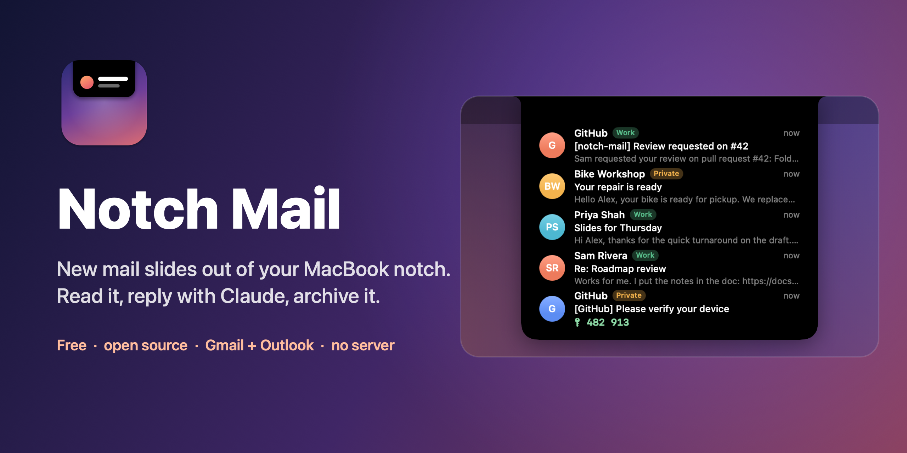
</p>

<p align="center">
  <a href="https://github.com/FelixSBuehrm/notch-mail/actions/workflows/ci.yml"></a>
  
  
  
  <a href="LICENSE"></a>
</p>

<p align="center">
  <b>Your inbox, one glance away.</b> A free, open source mail app that lives in the MacBook notch.<br>
  Gmail and Outlook. Replies drafted by Claude. Login codes in one click. No server, nothing on disk.
</p>

<p align="center">
  <a href="#quick-start"><b>Quick start</b></a>&nbsp;&nbsp;·&nbsp;&nbsp;
  <a href="#features"><b>Features</b></a>&nbsp;&nbsp;·&nbsp;&nbsp;
  <a href="#privacy"><b>Privacy</b></a>&nbsp;&nbsp;·&nbsp;&nbsp;
  <a href="docs/getting-started.md"><b>Setup guide</b></a>&nbsp;&nbsp;·&nbsp;&nbsp;
  <a href="#hack-on-it"><b>Hack on it</b></a>&nbsp;&nbsp;·&nbsp;&nbsp;
  <a href="CONTRIBUTING.md"><b>Contribute</b></a>
</p>

<br>

<p align="center">
  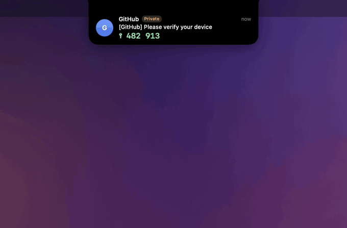
  <br>
  <sub>Recorded with the built-in demo mail. No real inbox in any picture here.</sub>
</p>

<br>

<table>
<tr>
<td width="33%" valign="top">
<br>
<b>Lives in the notch</b><br>
<sub>New mail peeks out and goes away by itself. Rest the pointer on the notch to see what's unread. No window, no Dock icon.</sub>
</td>
<td width="33%" valign="top">
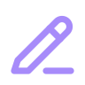<br>
<b>Replies with Claude</b><br>
<sub>Say what you want to say. Claude writes it in the thread's language and tone, you edit it, and Send gives you 5 seconds to undo.</sub>
</td>
<td width="33%" valign="top">
<br>
<b>Login codes</b><br>
<sub>"Your code is 482913" shows up big, copies with one click, and stays in the menu bar for 15 minutes.</sub>
</td>
</tr>
<tr>
<td width="33%" valign="top">
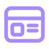<br>
<b>Mail as designed</b><br>
<sub>HTML mail keeps its layout, with JavaScript off and nothing loading from the internet until you say so.</sub>
</td>
<td width="33%" valign="top">
<br>
<b>Private by design</b><br>
<sub>No server, no analytics. Mail stays in memory, tokens in your Keychain. You bring your own OAuth clients.</sub>
</td>
<td width="33%" valign="top">
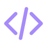<br>
<b>Small and hackable</b><br>
<sub>About 6,000 lines of Swift, zero dependencies, 198 tests. Builds with the Command Line Tools, no Xcode needed.</sub>
</td>
</tr>
</table>

---

<a id="quick-start"></a>

##  Quick start

```sh
git clone https://github.com/FelixSBuehrm/notch-mail.git
cd notch-mail
scripts/install.sh        # builds, copies to /Applications, starts it
```

An envelope icon appears in your menu bar, and a demo mail slides out of the notch so you can try it right away. Then connect your accounts:

| | What you need | Guide |
|---|---|---|
| **Gmail** | A free Google Cloud project with a "Desktop app" OAuth client | [Google setup](docs/google-setup.md) · ~10 min |
| **Outlook.com / Hotmail** | A free Azure app registration (public client flows on) | [Outlook setup](docs/outlook-setup.md) · ~5 min |
| **Claude drafts** *(optional)* | An Anthropic API key | [Anthropic key](docs/google-setup.md#anthropic-api-key-for-reply-drafts) · ~2 min |

New to all this? The **[getting-started guide](docs/getting-started.md)** walks through everything, step by step.

> [!NOTE]
> There's no download yet. Notch Mail isn't signed by Apple, so for now you build it yourself (it takes about a minute). macOS asks once per new build whether Notch Mail may read its Keychain item: choose **Always Allow**.

<a id="features"></a>

## 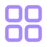 Features

<table>
<tr>
<td width="50%">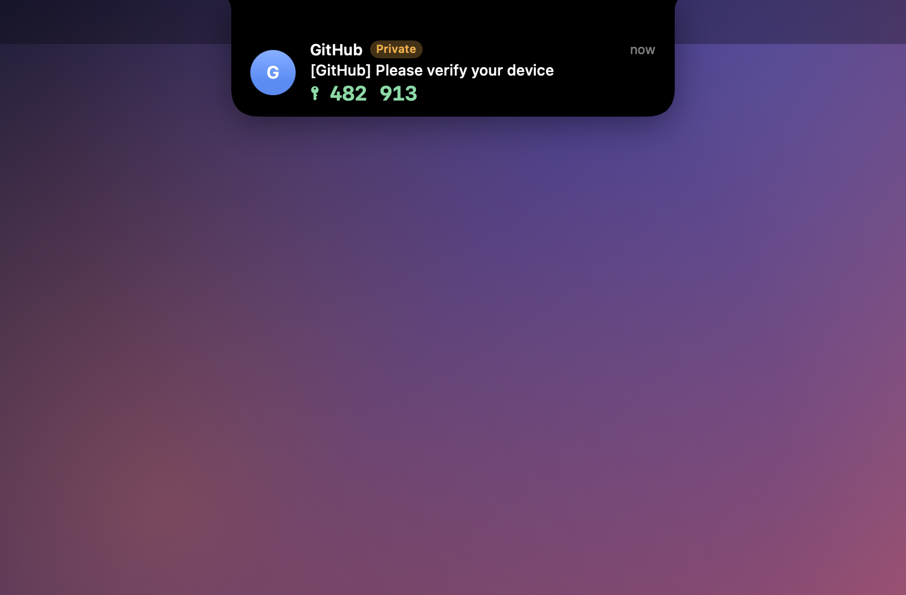</td>
<td width="50%">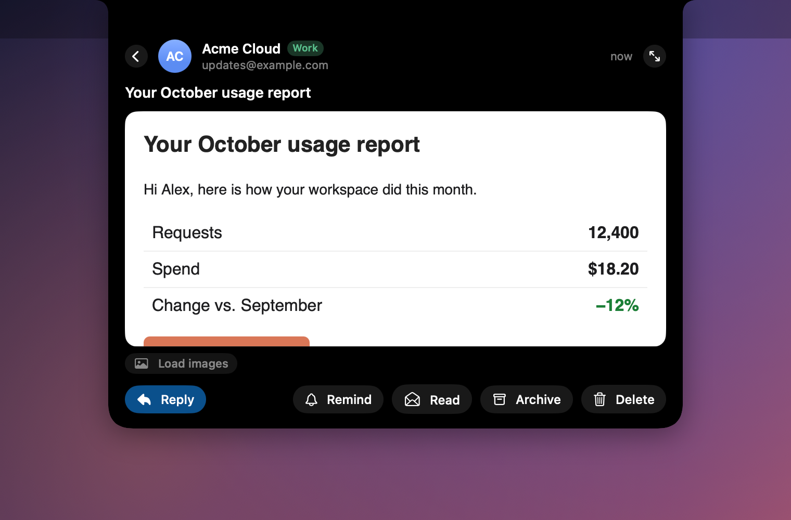</td>
</tr>
<tr>
<td align="center"><sub><b>New mail peeks out.</b> Codes show big.</sub></td>
<td align="center"><sub><b>HTML mail as designed.</b> Images only when you ask.</sub></td>
</tr>
<tr>
<td width="50%">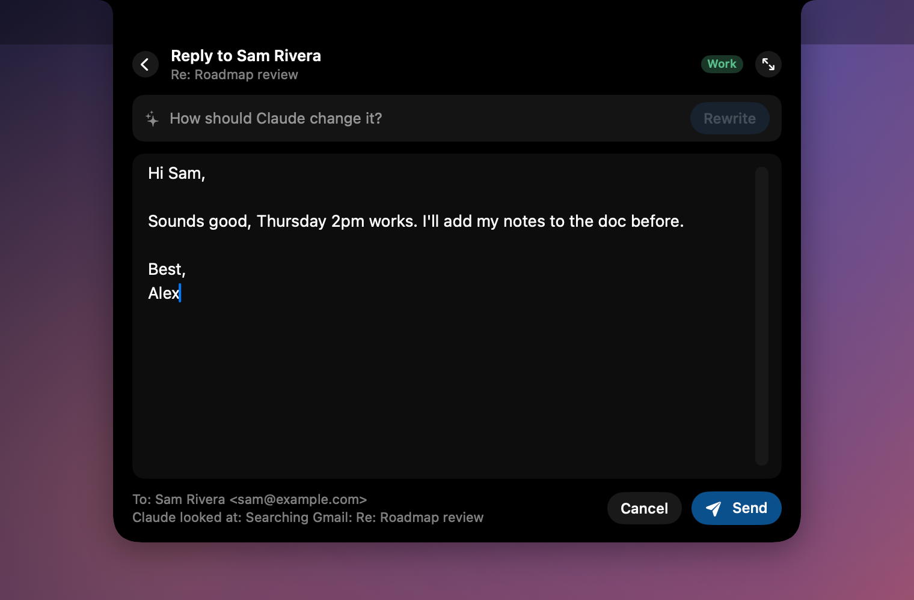</td>
<td width="50%">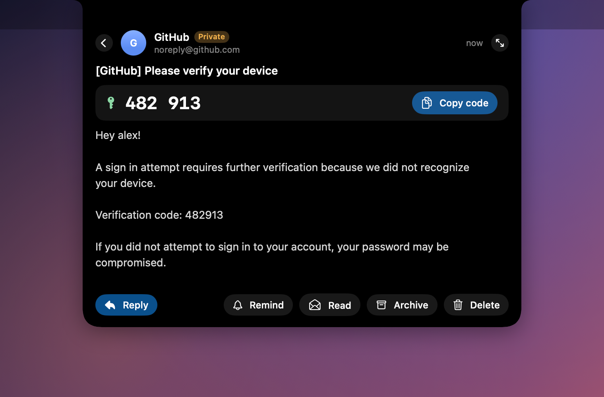</td>
</tr>
<tr>
<td align="center"><sub><b>Reply with Claude.</b> Edit, send, undo.</sub></td>
<td align="center"><sub><b>Login codes</b>, one click to copy.</sub></td>
</tr>
</table>

**Accounts:** Gmail and Outlook.com / Hotmail side by side, each with its own badge.<br>
**Rest to open:** the notch opens when the pointer *rests* on it, so moving to a screen above doesn't trigger it.<br>
**One-click actions:** Archive · Delete (recoverable) · Mark read · **Remind me** in 1 hour, this evening or tomorrow.<br>
**Reading:** quoted history folded away, tracking links shortened to `↗ host`, an enlarge button for long mail.<br>
**Claude, read-only:** while drafting it can search your mailbox (and Google Drive for Gmail). It never sends anything; you do.<br>
**Scrollable list** of 10, 20 or 50 unread mails · **hidden from screen sharing** · **opens at login** · checks every 10 s and on wake.

###  Roadmap

- [ ] Calendar invites: Yes / Maybe / No and Add to Calendar, right in the notch
- [ ] Photo attachments as thumbnails (newsletter images stay off on purpose)
- [ ] Reply all, and replies with attachments
- [ ] Sign-in links ("magic links") next to the codes
- [ ] Signed, notarized download + Homebrew cask ([plan](docs/distribution.md))

Ideas and pull requests are welcome; see [CONTRIBUTING.md](CONTRIBUTING.md). Deliberately **not** planned: read tracking.

<a id="privacy"></a>

##  Privacy

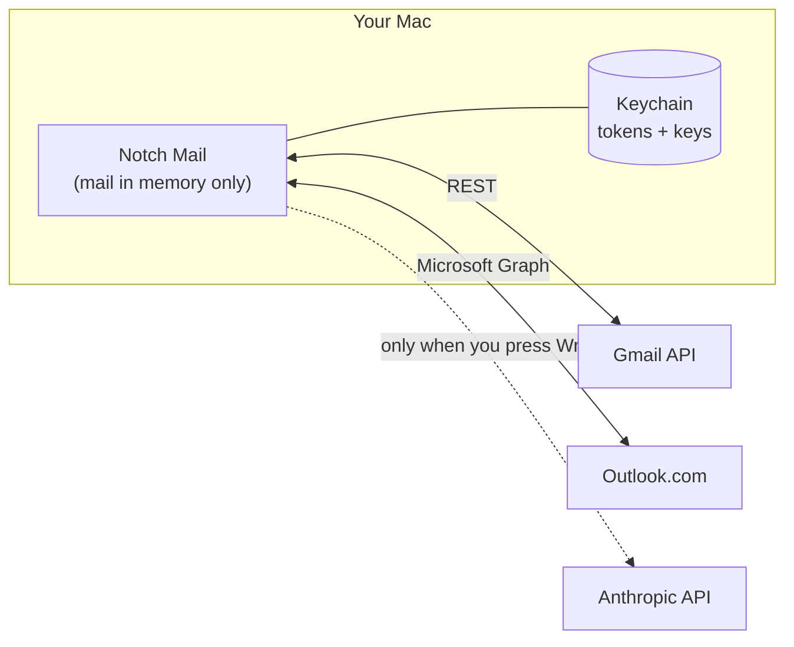

| What | Where it goes | Where it's kept |
|---|---|---|
| Your mail | Straight from Google or Microsoft to your Mac | **Memory only**, never written to disk |
| Sign-ins, OAuth client IDs, Anthropic key | Only to the provider they belong to | **One Keychain item** owned by the app |
| Reply drafts | The mail, your instruction and what Claude looks up go to Anthropic, **only when you press Write** | Memory only |
| Addresses, "Remind me" times, settings | Nowhere | `UserDefaults`, no mail content |

<details>
<summary><b>Security details</b></summary>

- **Google:** loopback redirect on `127.0.0.1` + PKCE. Scopes: `gmail.modify` (read, label, trash, send; can't permanently delete), optional `drive.readonly`, `openid`, `email`.
- **Microsoft:** device-code sign-in for personal accounts. Scopes: `Mail.ReadWrite`, `Mail.Send`, `User.Read`, `offline_access`.
- **Claude** gets read-only tools with a cap per draft, and a system prompt that treats mail and look-ups as information, never as instructions. The reply screen shows the real recipient and warns when Reply-To differs from the sender.
- **HTML mail** renders with JavaScript off, a non-persistent web store, and every network load blocked until "Load images". Links open in your browser.
- **Login codes** are copied as "concealed" (clipboard managers skip them) and cleared after 90 s.
- **Disconnect** revokes the Google token and forgets the Microsoft one.

Found a vulnerability? Please report it privately, see [SECURITY.md](SECURITY.md).
</details>

<a id="hack-on-it"></a>

##  Hack on it

```
Sources/
├── NotchCore/     Pure logic, no AppKit, fully unit-tested: the notch state machine,
│                  layout, inbox sync, quote folding, login codes, hover dwell
├── MailSources/   Foundation only: Google (OAuth, Gmail, Drive), Microsoft (device code,
│                  Graph), Claude (client + tool loop), MIME, HTML to text, Keychain
└── NotchMail/     The app: notch panel, coordinator, composer, SwiftUI views, menu
```

| I want to… | Start here |
|---|---|
| change how the notch behaves | `NotchCore/NotchState.swift`, a pure `state.applying(event)`. Add a test in `Tests/NotchCoreTests/` first. |
| change how it looks | `NotchMail/Views/`; sizes per state in `NotchCore/NotchLayout.swift` |
| change how Claude drafts | `MailSources/ReplyDrafter.swift` (prompt + tool loop) |
| add a provider (IMAP, iCloud, Microsoft 365) | implement `MailSource` like `OutlookSource`, attach it in `MailCoordinator` |

```sh
scripts/test.sh                                   # all tests, Command Line Tools are enough
open -n build/NotchMail.app --args --demo-only --demo 3 --open-first --capturable
scripts/screenshots/make.sh                       # regenerate the screenshots (demo mail only)
scripts/screenshots/record.sh                     # re-record the GIF above
```

<details>
<summary><b>All dev flags</b></summary>

| Flag | What it does |
|---|---|
| `--demo-only` | Demo mail only: no Keychain, no network, fictional names. Safe for UI work and recordings. |
| `--demo N` | Deliver N demo messages shortly after launch (max 20). |
| `--open-first` | Open the newest demo message. |
| `--open-reply` | Same, then open Reply (canned drafts, no Anthropic key needed). |
| `--auto-draft "…"` | With `--open-reply`: write a demo draft from this instruction. |
| `--long-draft` | With `--open-reply`: prefill a long draft. |
| `--open-list` | Open the list. |
| `--enlarged` | Start in the bigger reading size. |
| `--tour` | Play the scripted tour from the GIF. |
| `--pin` | Ignore the pointer, so the notch stays as opened. |
| `--capturable` | Let screenshots and screen sharing see the notch (hidden by default). |
</details>

<a id="limitations"></a>

##  Limitations

Honest list. This is an early project.

- **Gmail and Outlook.com / Hotmail only,** one account each. No IMAP, iCloud or Microsoft 365 work accounts yet.
- **Bring your own OAuth clients and Anthropic key.** Gmail's `gmail.modify` is a restricted scope: a shared client would need Google's yearly paid security assessment. Your own client is free and keeps your data between your Mac and your provider.
- **Replies are plain text,** to the sender or their Reply-To. No reply-all, attachments or signatures yet.
- **No signed download yet,** so macOS asks about the Keychain once per new build.
- **Made for notched MacBooks.** Elsewhere it shows a notch-shaped panel at the top of the screen.

<a id="faq"></a>

##  FAQ

<details>
<summary><b>Does it store my mail anywhere?</b></summary>

No. Mail lives in memory while the app runs. Only account addresses, "Remind me" times and settings are saved, in `UserDefaults`.
</details>

<details>
<summary><b>Does Claude read all my mail?</b></summary>

No. Claude sees the mail you're replying to, your instruction, and what it looks up for that one draft (listed under the draft). Nothing goes to Anthropic unless you press **Write**.
</details>

<details>
<summary><b>Why do I need my own Google Cloud project?</b></summary>

Reading Gmail needs a restricted scope, and a shared client would need Google's paid yearly security assessment. Your own client is free, private to you, and nobody else is ever in the loop. See [docs/google-setup.md](docs/google-setup.md).
</details>

<details>
<summary><b>Google asks me to reconnect every week.</b></summary>

Your OAuth consent screen is **External** in **Testing**, and Google expires those sign-ins after 7 days. The [setup guide](docs/google-setup.md) shows the fix.
</details>

<details>
<summary><b>Do I have to enter the Microsoft code every time?</b></summary>

No, once. The sign-in renews itself as long as the app runs at least once every 90 days.
</details>

<details>
<summary><b>Will the notch show up when I share my screen?</b></summary>

No. It's excluded from screen sharing and recordings unless you start it with `--capturable`.
</details>

<details>
<summary><b>How do I uninstall it?</b></summary>

Quit it from the menu, delete `/Applications/NotchMail.app`, and remove the Keychain items starting with `notchmail.` (Keychain Access → search "notchmail"). If you built from source, also delete `~/Library/Keychains/notchmail-signing.keychain-db`.
</details>

<a id="license"></a>

##  License

[MIT](LICENSE) © Felix Bührmann
